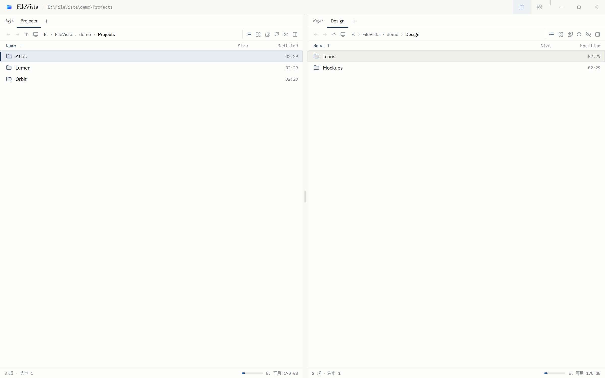
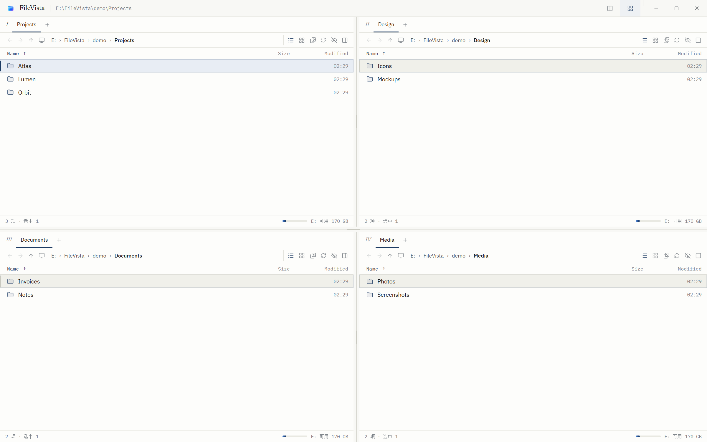
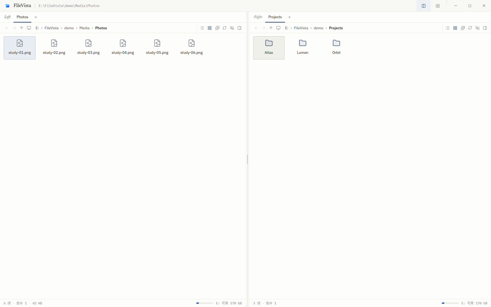
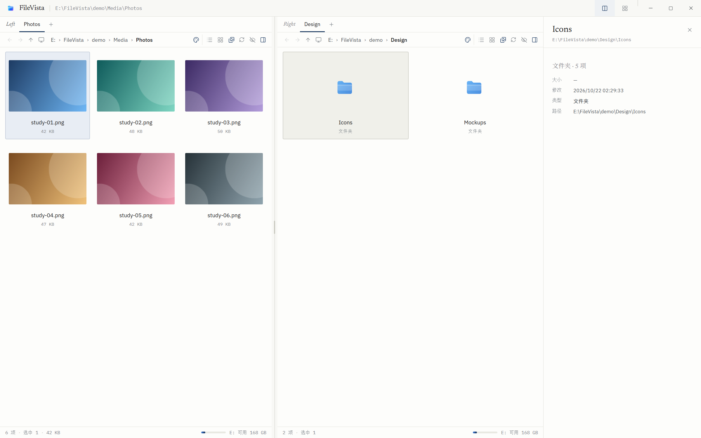
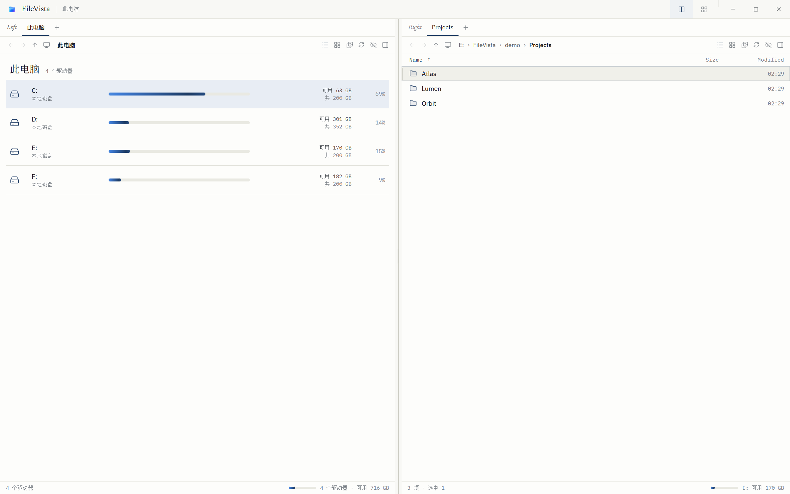

<p align="center">
  
</p>

<h1 align="center">FileVista</h1>

<p align="center">
  <em>对开账簿式的 Windows 文件管理器。</em><br />
  A keyboard-first, dual-pane file manager with a paper-inspired interface.
</p>

<p align="center">
  <a href="CHANGELOG.md"></a>
  <a href="LICENSE"></a>
  
  
  
  <a href="CONTRIBUTING.md"></a>
</p>

<p align="center">
  
</p>

> **状态**：0.4.1，可日常使用的 MVP。仅支持 Windows，暂无签名安装包。  
> **English**：FileVista is a dual-pane Windows file manager with a restrained paper-and-ink interface, a command palette, native shell integration, and no telemetry.

---

## 目录

| 开始 | 深入 |
| --- | --- |
| [为什么是 FileVista](#为什么是-filevista) | [键盘](#键盘) |
| [功能](#功能) | [设计系统](#设计系统) |
| [截图](#截图) | [架构](#架构) |
| [安装与构建](#安装与构建) | [开发](#开发) |
| [使用方式](#使用方式) | [安全](#安全) |
| [路线图](#路线图) | [贡献与许可](#贡献与许可) |

---

## 为什么是 FileVista

大多数文件管理器要么停留在 2005 年的界面，要么为了“现代”牺牲信息密度。FileVista 想在两者之间找一条线：

- **像书一样摊开**：左右两栏是一本书的两页，中间是书脊；四宫格也只是同一本书多翻了一页。
- **键盘优先**：`Ctrl+K` 能到达所有动作，鼠标只是入口之一。
- **信息密度不妥协**：13px 文件名、等宽数字、30px 行高，一屏看到更多。
- **不装饰**：没有卡片、渐变背景、发光阴影；纸感来自排版、栏线和留白。
- **承认 Windows 的存在**：原生 Shell 右键、回收站、隐藏属性、长路径、Beyond Compare。

它不试图取代 Explorer 的全部功能，也不追求 Total Commander 的插件生态；它先把“双栏浏览 + 文件操作 + 快速定位”做顺。

---

## 功能

### 布局与浏览

| | |
| --- | --- |
| **双栏 / 四宫格** | 标题栏按钮或 `Ctrl+Alt+1` / `Ctrl+Alt+2`；横向、纵向分隔条都可拖动 |
| **标签页** | 每栏独立标签、历史、排序；会话自动保存 |
| **面包屑与路径** | 点击跳转、`Ctrl+L` 输入完整路径、前进/后退/上一级 |
| **排序** | 名称（自然排序）、大小、修改时间、类型；文件夹优先 |
| **隐藏文件** | 读取 Win32 `FILE_ATTRIBUTE_HIDDEN`，`AppData` 等真正隐藏 |
| **此电脑** | 地址栏“显示器”按钮：驱动器容量、剩余空间、使用率与动态渐变条 |
| **自动刷新** | `fs.watch` 监听当前目录，窗口重新聚焦时也刷新 |
| **大目录** | 列表与网格都使用虚拟滚动，只渲染可见区域 |

### 文件操作

| | |
| --- | --- |
| **复制 / 移动** | 后台执行、状态栏进度、可取消；`F5` / `F6` 发往配对栏 |
| **冲突策略** | 替换 / 跳过 / 保留两者；目录合并，文件按策略处理 |
| **重命名 / 新建 / 删除** | `F2`、`Ctrl+Shift+N`、`Delete` 到回收站 |
| **拖放** | 栏间拖动（默认移动，`Ctrl` 复制）；从资源管理器拖入；多选拖出到桌面 |
| **打开方式** | 双击默认程序打开；右键原生菜单含“打开方式 / 发送到 / 属性” |
| **Beyond Compare** | 选中两项比较，或当前项与另一栏选中项比较；自动定位 `BCompare.exe` |

### 视图与预览

| | |
| --- | --- |
| **列表** | 名称 / 大小 / 修改时间，列头排序，行内选中条 |
| **小图标** | 网格布局，适合快速扫视 |
| **超大图标** | 系统缩略图（图片 / 视频 / ICO），右侧自动打开图片预览 |
| **预览抽屉** | 文本（≤256 KB）、图片（≤12 MB）、尺寸、修改时间、路径 |
| **缩略图缓存** | 主进程按 `路径 + mtime + 尺寸` 缓存，最多 600 张，分批加载 |

### 系统集成

| | |
| --- | --- |
| **原生右键** | 单文件/文件夹右键直接弹出 Windows Shell 菜单，包含 7-Zip、Beyond Compare 等扩展 |
| **主题右键** | 多选或 `Ctrl+右键` 使用 FileVista 菜单（复制到另一栏、比较、回收站等） |
| **隐藏属性** | `koffi` 调用 `GetFileAttributesW`，不是按文件名猜测 |
| **长路径** | 统一转换为 `\\?\` / `\\?\UNC\` 后再调用文件系统 |
| **安全边界** | `contextIsolation` + `sandbox` + 关闭 `nodeIntegration` |
| **关闭行为** | 点 `X` 最小化到任务栏；任务栏缩略图上的“退出”、任务栏跳转列表或托盘菜单才彻底退出 |
| **启动** | 等首帧渲染完成后再显示窗口，避免空白/小窗闪烁 |

---

## 截图

| 双栏 · 列表 | 四宫格 |
| :---: | :---: |
|  |  |
| **小图标** | **超大图标 + 预览** |
|  |  |
| **此电脑 · 容量条** | **状态栏迷你容量条** |
|  | 每个窗格右下角显示当前磁盘的迷你渐变条与可用空间 |

---

## 安装与构建

### 环境要求

- Windows 10 / 11（x64）
- Node.js **20+**
- npm 10+
- .NET Framework 4.x（仅重建原生右键桥时需要，Windows 自带）

### 从源码运行

```powershell
git clone https://github.com/jeffecai/FileVista.git
cd FileVista
npm ci
npm run dev
```

`npm run dev` 会同时启动 Vite 与 Electron，支持热更新。

### 生产构建并启动

```powershell
npm run build
.\FileVista.cmd
```

也可以：

```powershell
npm start
```

> 构建产物是 `dist/` 静态资源 + Electron 运行时，没有安装包。安装包与代码签名在路线图中。

### 重建原生右键桥

只有修改 `native/ShellMenu.cs` 后才需要：

```powershell
npm run build:native
native\ShellMenu.exe --path .\README.md --dump
```

`--dump` 会打印系统菜单树而不显示菜单，适合调试与 CI。

---

## 使用方式

### 1. 双栏搬运

左栏选文件，`F5` 复制到右栏，`F6` 移动。冲突时选择替换 / 跳过 / 保留两者。复制过程中底栏显示进度，可取消。

### 2. 快速定位

- `Ctrl+K` 打开命令面板：搜索动作、跳转路径、切换布局和视图。
- `Ctrl+L` 输入路径；`Backspace` 上一级；`Tab` 切换栏。
- 地址栏的显示器按钮直达“此电脑”。

### 3. 看图和审阅

`Ctrl+Alt+5` 切到超大图标，右侧自动打开预览。选中图片即可看到原图、尺寸和路径；`Space` 可随时开关预览。

### 4. 右键

- **单击右键单个项目**：Windows 原生菜单，系统扩展全部可用。
- **多选后右键** 或 **`Ctrl+右键`**：FileVista 菜单，包含“复制到另一栏”“用 Beyond Compare 比较”等。
- 空白处右键：当前文件夹操作（新建、刷新、隐藏文件、预览）。

### 5. 与 Beyond Compare 比较

同栏选中两项 → 右键“用 Beyond Compare 比较”；或当前栏选一项、另一栏也选一项 → “与另一栏选中项比较”。首次找不到 BC 时会弹出文件选择框，并记住路径。

### 6. 最小化与退出

点右上角 `X` 只是**最小化到任务栏**，文件操作与标签都保留。要彻底退出：

- 悬停任务栏图标 → 缩略图上的 **退出** 按钮，或
- 右键任务栏图标 → **退出 FileVista**（Jump List 任务），或
- 右键系统托盘里的 FileVista 图标 → **退出 FileVista**。

这样误点关闭不会中断长复制，也不会丢失会话。

---

## 键盘

| 键 | 行为 |
| --- | --- |
| `↑` `↓` | 移动光标（网格视图按列移动） |
| `Shift` + `↑↓` | 扩展选择 |
| `←` `→` | 网格视图左右移动 |
| `Enter` | 进入目录 / 打开文件 |
| `Backspace` | 上一级 |
| `Tab` | 切换栏（双栏 2 个，四宫格 4 个） |
| `Ctrl+L` | 路径输入 |
| `Ctrl+T` / `Ctrl+W` | 新建 / 关闭标签 |
| `Ctrl+Tab` | 下一个标签 |
| `Ctrl+A` | 全选 |
| `Ctrl+R` | 刷新 |
| `Ctrl+K` | 命令面板 |
| `Ctrl+Shift+N` | 新建文件夹 |
| `Ctrl+Shift+C` | 复制路径 |
| `F2` | 重命名 |
| `Delete` | 移到回收站 |
| `F5` / `F6` | 复制 / 移动到配对栏 |
| `Space` | 预览 |
| `Ctrl+Alt+1` / `Ctrl+Alt+2` | 双栏 / 四宫格 |
| `Ctrl+Alt+3` / `Ctrl+Alt+4` / `Ctrl+Alt+5` | 列表 / 小图标 / 超大图标 |

---

## 设计系统

FileVista 的视觉母题是**对开账簿**：两栏是一本书摊开的两页，中间是一道书脊，而不是两块并排的卡片。

| Token | 值 | 用途 |
| --- | --- | --- |
| Paper | `#F8F8F5` | 应用底色，冷调纸白 |
| Page | `#FDFDFB` | 文件列表页心 |
| Ink | `#17181A` | 主文字 |
| Rule | `#E1E1DA` | 发丝线 |
| Accent | `#1D3B63` | 墨蓝：焦点、选中、链接 |
| Danger | `#9C3B2E` | 仅用于删除/覆盖 |

- **字体**：Newsreader（标题/品牌）+ IBM Plex Sans（文件名）+ IBM Plex Mono（数字/路径），中文标题由 Noto Serif SC 承接。
- **结构**：无卡片、无装饰渐变；标签是书页索引签，选中是 2px 墨蓝竖条。
- **动效**：只有一个 120ms 的响应动画；容量条是唯一持续动画，并可被“减少动态效果”关闭。

完整规范见 [docs/DESIGN.md](docs/DESIGN.md)。

---

## 架构

```text
Renderer (React + Zustand, no Node)
        │  window.folio.*  (typed IPC)
Preload (contextBridge whitelist)
        │  ipcMain.handle / webContents.send
Main process
  ├─ filesystem engine (electron/fs-service.cjs)
  ├─ window + session + watchers
  ├─ thumbnails (nativeImage, cached)
  ├─ Beyond Compare (electron/compare.cjs)
  └─ native/ShellMenu.exe  (C# / COM, Windows shell menu)
```

关键约束：

- 所有文件系统操作在**主进程**，渲染层只通过 `preload.cjs` 暴露的白名单 API。
- 路径先经过绝对路径校验与长路径转换，再进入 Node API。
- 复制不跟随目录符号链接，失败会清理半成品文件；取消是协作式的。
- 会话与窗口尺寸分别保存在 `session.json` / `window.json`。

更完整的设计说明、IPC 表、数据模型与测试策略见 [docs/ARCHITECTURE.md](docs/ARCHITECTURE.md)。

### 目录结构

```text
FileVista/
├─ electron/          # 主进程：窗口、IPC、文件系统引擎、测试
│  ├─ main.cjs
│  ├─ preload.cjs
│  ├─ fs-service.cjs
│  ├─ paths.cjs
│  ├─ compare.cjs     # Beyond Compare 定位与启动
│  ├─ selftest.cjs
│  └─ dragtest.cjs
├─ native/            # Windows Shell 右键桥（C# / COM）
│  ├─ ShellMenu.cs
│  └─ ShellMenu.exe
├─ src/               # 渲染层
│  ├─ components/
│  ├─ lib/
│  ├─ store.ts
│  ├─ styles.css
│  └─ App.tsx
├─ docs/              # 设计、架构、截图
├─ scripts/           # 原生桥构建脚本
├─ assets/            # 应用图标
├─ .github/           # CI 与 issue/PR 模板
├─ CHANGELOG.md
├─ CONTRIBUTING.md
├─ SECURITY.md
└─ THIRD_PARTY_NOTICES.md
```

---

## 开发

```powershell
npm ci
npm run dev            # Vite + Electron，热更新
npm run build          # tsc --noEmit + vite build
npm run start          # 构建后启动
npm run test           # 文件系统引擎自测（17 项，无窗口）
npm run test:drag      # CDP 模拟外部拖放
npm run build:native   # 重建 ShellMenu.exe
npm run smoke          # 构建并截图到 smoke*.png
```

测试覆盖：列目录、重命名、递归复制、冲突跳过/保留两者、空文件夹计数、移动、332 字符长路径、回收站、缺失路径、文本预览、冲突检测、Win32 隐藏属性。

### 项目数据

| 内容 | 位置 |
| --- | --- |
| 标签、路径、布局、视图、排序 | `%APPDATA%\FileVista\session.json` |
| 窗口尺寸 | `%APPDATA%\FileVista\window.json` |
| Beyond Compare 路径 | `%APPDATA%\FileVista\settings.json` |
| 构建产物 | `dist/`（已 gitignore） |

不写注册表、不注册文件关联、不开机启动；删除程序目录即卸载。

---

## 安全

- 渲染层沙箱化：`contextIsolation: true`、`sandbox: true`、`nodeIntegration: false`
- 所有路径在主进程校验；打开文件只走 `shell.openPath`
- Beyond Compare 与 Shell 菜单均以参数数组启动，不经过 shell 字符串拼接
- 原生菜单桥只接受一个路径参数，并调用 Windows 自身的 `IContextMenu`

报告漏洞请使用 GitHub 的私密安全公告，详见 [SECURITY.md](SECURITY.md)。

---

## 已知限制

- 仅支持 Windows；没有 macOS / Linux 计划。
- 没有安装包、自动更新或代码签名。
- 右键原生菜单目前支持**单个**项目；多选使用 FileVista 主题菜单。
- 原生 Shell 菜单由 Windows 绘制，跟随系统主题，应用无法改色。
- 缩略图依赖 Windows 缩略图服务，部分格式只显示类型图标。
- 暂无快速过滤、文件夹大小列、操作队列、批量重命名、文件搜索。

---

## 路线图

- [x] 双栏 / 四宫格、标签、虚拟滚动
- [x] 复制/移动、冲突策略、回收站、长路径
- [x] 三种视图 + 系统缩略图 + 图片预览
- [x] 原生 Shell 右键、Beyond Compare
- [x] 此电脑容量视图与渐变容量条
- [ ] 快速过滤（输入即筛选）
- [ ] 文件夹大小列 / 按需统计
- [ ] 操作队列（暂停、继续、重试、速度）
- [ ] 多重重命名（正则、计数器）
- [ ] 文件搜索（递归、掩码、内容）
- [ ] 多选原生 Shell 菜单
- [ ] 安装包与代码签名

---

## 贡献与许可

欢迎提交 issue 与 pull request。开始之前请阅读：

- [CONTRIBUTING.md](CONTRIBUTING.md) — 环境、代码风格、提交与测试要求
- [CODE_OF_CONDUCT.md](CODE_OF_CONDUCT.md) — 社区行为准则
- [docs/ARCHITECTURE.md](docs/ARCHITECTURE.md) — 进程边界与 IPC 约定
- [docs/DESIGN.md](docs/DESIGN.md) — 视觉与交互规范

本项目使用 [MIT License](LICENSE)。字体（SIL OFL）、图标（ISC）与依赖的许可信息见 [THIRD_PARTY_NOTICES.md](THIRD_PARTY_NOTICES.md)。

<p align="center">
  <sub>Built with Electron, React, and a preference for quiet interfaces.</sub>
</p>
